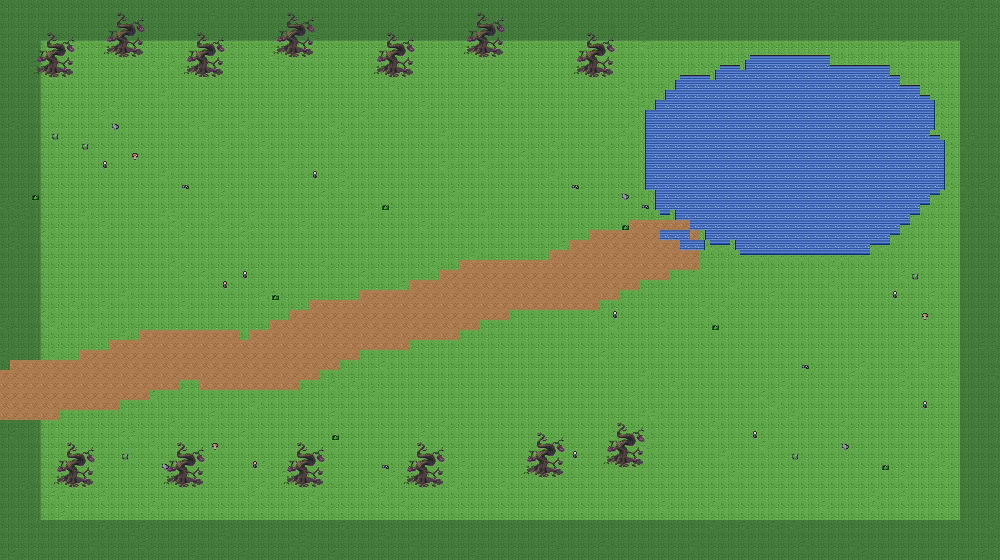
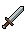
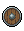
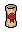

<div align="center">


<br/>


<br/>


<br/>

```text
╔════════════════════════════════════════════╗
║                                            ║
║         THE PIXELBOUND CHRONICLES          ║
║                                            ║
║           ~ Code Explorer Saga ~           ║
║                                            ║
║              > NEW GAME                    ║
║                CONTINUE                    ║
║                OPTIONS                     ║
║                                            ║
║      (c) 2026 FAIROZI  -  PRESS START      ║
╚════════════════════════════════════════════╝
```

*Setiap baris kode membuka dunia baru. Setiap tantangan membawa kita naik level.*

<br/>

<a href="https://github.com/fairozi-dev"></a>
<a href="https://peminjamanalat.site.je/"></a>

<br/><br/>


`STATUS: TERUS BELAJAR · TERUS BERKEMBANG`

<br/>



<sub>SEBUAH DUNIA YANG DIBANGUN DARI RASA INGIN TAHU DAN KETEKUNAN</sub>

</div>

---

## 🧝 PROFIL KARAKTER

<div align="center">

```text
╔═ LAYAR STATUS ═════════════════════════════════╗
║  PEMAIN : FAIROZI                              ║
║  CLASS  : CODE EXPLORER                        ║
║  GUILD  : TEKNIK INFORMATIKA - UNESA           ║
║  LEVEL  : MAHASISWA S1 (SEDANG NAIK LEVEL)     ║
╠════════════════════════════════════════════════╣
║  HP  ██████████ 100%  SEMANGAT                 ║
║  MP  █████████░  90%  RASA INGIN TAHU          ║
║  XP  ██████░░░░  60%  PROGRES BELAJAR          ║
╠════════════════════════════════════════════════╣
║  QUEST AKTIF : MEMPERKUAT DASAR PEMROGRAMAN    ║
╚════════════════════════════════════════════════╝
```

</div>

<table>
<tr>
<td width="58%" valign="top">

### 📜 Catatan Petualang

Halo, petualang!

Saya mahasiswa **S1 Teknik Informatika Universitas Negeri Surabaya (UNESA)** yang sedang menjelajahi dunia pemrograman, satu quest dalam satu waktu.

Saya tertarik mempelajari cara kerja aplikasi, membangun proyek yang bermanfaat, memecahkan masalah, dan mencoba teknologi baru.

Bagi saya, setiap bug adalah monster yang harus dikalahkan, setiap proyek adalah dungeon yang harus dijelajahi, dan setiap solusi adalah level baru yang berhasil dibuka.

</td>
<td width="42%" valign="top">

### ⚔️ Atribut Pemain

| Atribut | Status |
|:--|:--|
| Nama | Fairozi |
| Class | Code Explorer |
| Realm | Informatika |
| Senjata Utama | Keyboard |
| Skill | Problem Solving |
| Misi Aktif | Level Up |

</td>
</tr>
</table>

<div align="center">


```text
┌─ GURU PETUALANG ─────────────────────────────┐
│                                              │
│  "Setiap bug adalah monster yang bisa        │
│   dikalahkan. Terus maju, petualang!"        │
│                                              │
│                                  [v] LANJUT  │
└──────────────────────────────────────────────┘
```

</div>

---

## 🗺️ PETA PETUALANGAN

<div align="center">

| 🌲 HUTAN ZAMRUD | 🏰 KASTEL DEVELOPER | 🔮 DUNIA BERIKUTNYA |
|:---:|:---:|:---:|
| Mempelajari dasar pemrograman | Membangun aplikasi nyata | Menjelajahi teknologi baru |
| `LEARNING` | `BUILDING` | `DISCOVERING` |

```text
╔═ PETA DUNIA ═══════════════════════════════════════════════╗
║                                                            ║
║  [1] HUTAN ZAMRUD       : BELAJAR DASAR                    ║
║    |                                                       ║
║    +--[2] TEMPAT LATIHAN    : ASAH SKILL                   ║
║         |                                                  ║
║         +--[3] KASTEL DEVELOPER  : BANGUN PROYEK           ║
║              |                                             ║
║              +--[4] DUNIA BERIKUTNYA  : TEKNOLOGI BARU     ║
║                                                            ║
║  LEGENDA : [#] AREA   |   +--> JALUR PETUALANGAN           ║
║                                                            ║
╚════════════════════════════════════════════════════════════╝
```

</div>

---

## 🎒 INVENTORY — KOLEKSI ITEM

*Peralatan yang menemani perjalanan saya di dunia teknologi.*

<div align="center">

<table>
<tr>
<td align="center" width="100">

<br/><sub>CODE BLADE</sub>
</td>
<td align="center" width="100">

<br/><sub>DEFENSE</sub>
</td>
<td align="center" width="100">

<br/><sub>RECOVERY</sub>
</td>
<td align="center" width="100">

<br/><sub>RARE SKILL</sub>
</td>
<td align="center" width="100">

<br/><sub>KNOWLEDGE</sub>
</td>
<td align="center" width="100">

<br/><sub>EXPLORATION</sub>
</td>
</tr>
</table>

</div>

### 🛡️ Perlengkapan Terpasang

<div align="center">

| Slot | Item | Efek |
|:--|:--|:--|
| ⚔️ Senjata | Keyboard | Menebas bug dan menulis mantra kode |
| 🏰 Armor | Visual Studio Code | Menjaga fokus selama bertarung |
| 🛡️ Perisai | Git dan GitHub | Melindungi dari kehilangan progres |
| 📜 Grimoire | MySQL | Menyimpan catatan data petualangan |
| 🧥 Jubah | Bootstrap | Membuat tampilan aplikasi lebih rapi |
| 🧭 Kompas | Linux | Menjelajahi dunia terminal |

</div>

### 🪄 Sihir Pemrograman

<div align="center">


<br/><br/>


</div>

### 📖 Buku Mantra

<div align="center">

| Mantra | Tingkat | Status |
|:--|:--:|:--:|
| PHP | ★★★☆☆ | `AKTIF DIPAKAI` |
| MySQL | ★★★☆☆ | `AKTIF DIPAKAI` |
| HTML dan CSS | ★★★☆☆ | `AKTIF DIPAKAI` |
| Bootstrap | ★★★☆☆ | `AKTIF DIPAKAI` |
| JavaScript | ★★☆☆☆ | `LATIHAN` |
| Git dan GitHub | ★★☆☆☆ | `LATIHAN` |
| C++ | ★★☆☆☆ | `LATIHAN` |
| Python | ★★☆☆☆ | `LATIHAN` |

</div>

<sub>Teknologi di atas merupakan alat yang saya gunakan atau sedang pelajari. Perjalanan untuk menguasai semuanya masih terus berlangsung.</sub>

---

## 📜 QUEST UTAMA — GUILD PEMINJAMAN ALAT

<div align="center">


### 🧰 SISTEM PEMINJAMAN ALAT

*Aplikasi web untuk mengelola peminjaman, verifikasi, pengembalian, dan laporan alat.*

```text
╔═ QUEST UTAMA ══════════════════════════════════════╗
║                                                    ║
║  NAMA     : SISTEM PEMINJAMAN ALAT                 ║
║  GUILD    : GUILD PEMINJAMAN ALAT                  ║
║  STATUS   : SELESAI DI-DEPLOY                      ║
║  REWARD   : PENGALAMAN MEMBANGUN APLIKASI WEB      ║
║                                                    ║
╚════════════════════════════════════════════════════╝
```

<a href="https://peminjamanalat.site.je/"></a>

</div>

<table>
<tr>
<td width="50%" valign="top">

### 🎯 Tujuan Quest

- Mengelola data alat dan kategori.
- Mengajukan peminjaman alat.
- Memverifikasi permohonan.
- Melacak peminjaman dan pengembalian.
- Membuat laporan peminjaman.

</td>
<td width="50%" valign="top">

### ⚙️ Teknologi yang Digunakan

- PHP
- MySQL / MariaDB
- HTML dan CSS
- JavaScript
- Bootstrap

</td>
</tr>
</table>

<div align="center">

**STATUS QUEST: SELESAI DI-DEPLOY**

[🌐 **KUNJUNGI APLIKASI →**](https://peminjamanalat.site.je/)

</div>

> Demo aplikasi tersedia secara publik, sedangkan repositori source code proyek tetap privat.

---

## 📊 STATISTIK PEMAIN

<div align="center">


<br/><br/>


</div>

---

## 🏆 GALERI ACHIEVEMENT

<div align="center">

| Achievement | Deskripsi | Status |
|:--|:--|:--:|
| 🧭 First Steps | Memulai perjalanan pemrograman | `UNLOCKED` |
| 🛠️ The Builder | Membangun aplikasi fungsional | `UNLOCKED` |
| 🌐 World Explorer | Meluncurkan website | `UNLOCKED` |
| 🐛 Bug Hunter | Belajar melalui debugging | `IN PROGRESS` |
| 🔮 Code Apprentice | Mempelajari teknologi baru | `IN PROGRESS` |
| 👑 Future Legend | Terus berkembang sebagai developer | `ONGOING` |

</div>

<sub>Achievement di atas adalah pencapaian pribadi dalam perjalanan belajar, bukan achievement resmi GitHub.</sub>

---

## 📖 QUEST LOG

- [x] Memulai belajar pemrograman.
- [x] Membangun aplikasi berbasis web.
- [x] Meluncurkan proyek secara online.
- [x] Membuat profil GitHub.
- [ ] Memperkuat dasar pemrograman.
- [ ] Membuat lebih banyak proyek.
- [ ] Mempelajari framework modern.
- [ ] Berkontribusi pada proyek open-source.
- [ ] Membuka skill developer baru.

<details>
<summary><b>🗝️ RUANGAN RAHASIA (klik untuk membuka)</b></summary>

<br/>

```text
CHEAT CODE DITEMUKAN!

  ↑ ↑ ↓ ↓ ← → ← → B A

  +30 SEMANGAT NGODING
  +1  CANGKIR KOPI (OPSIONAL)
```

Terima kasih sudah menjelajah sampai ruangan ini. Semoga petualanganmu juga penuh level baru. 🌟

</details>

---

<div align="center">

```text
╔═ CONTINUE? ════════════════════════════════╗
║                                            ║
║         PETUALANGAN BELUM BERAKHIR         ║
║                                            ║
║          > YA, LANJUT BERPETUALANG         ║
║            YA, TAPI NGOPI DULU             ║
║                                            ║
╚════════════════════════════════════════════╝
```


## 🌙 PETUALANGAN BERLANJUT

*Di balik bug berikutnya, selalu ada skill baru yang menunggu untuk ditemukan.*

**BELAJAR · MEMBANGUN · DEBUGGING · BERKEMBANG**

<a href="https://github.com/fairozi-dev"></a>
<a href="https://peminjamanalat.site.je/"></a>

<br/><br/>


<sub>Dibangun dengan rasa ingin tahu · Digerakkan oleh kode · Terinspirasi dunia pixel fantasy RPG</sub>

</div>
